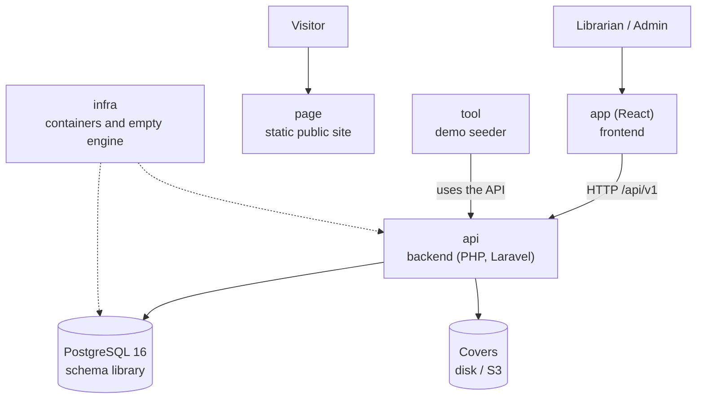

# Architecture on one page — Manager Library

A five-minute read before opening the rest. The detail is in [`architecture.md`](architecture.md).

## The system in one picture

## The six repositories and their role

| Repo | Role | Tested with |
|---|---|---|
| `docs` | The specification | That reading it is enough to build |
| `api` | Business rules and HTTP contract | Domain, application, contract and concurrency tests |
| `app` | Operations screens | An end-to-end walkthrough: login → lend → return → report |
| `page` | Public presentation, never calls the API | Looking good on mobile and desktop |
| `infra` | `docker compose up` and the empty database | Starting with a single command |
| `tool` | Demo data (books, members, loans) | The presentation fair having real data |

## The five ideas that hold the design together

1. **A loan is an immutable fact**; only a line's `returned_at` changes.
2. **Copies are withdrawn and restocked inside the same operation** that creates or closes the line.
3. **Status is computed**: `open`, `overdue` or `closed` are not in the database.
4. **Frozen values do not follow the catalog**: October's report does not change because a book is renamed in November.
5. **The database is the last barrier**: if the copies `CHECK` fires, something wrote outside the system.
