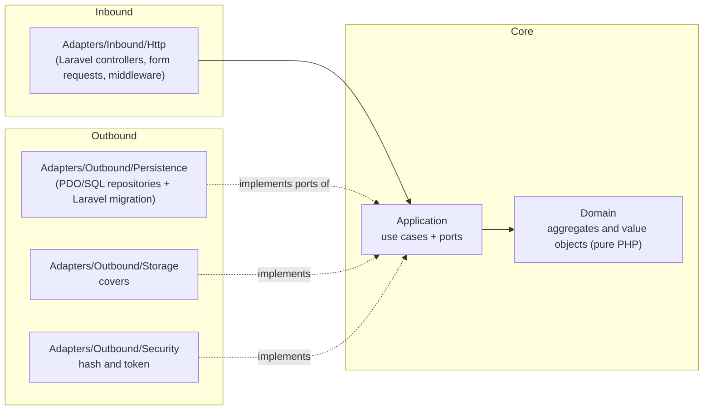
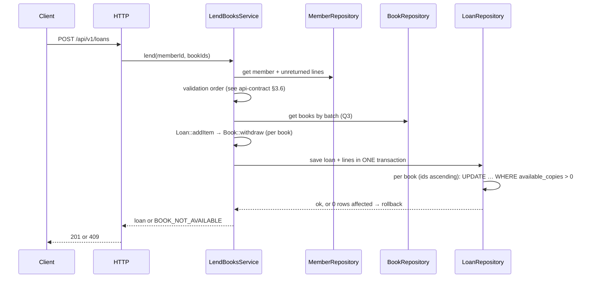

# Architecture — Manager Library (Laravel + React)

**Hexagonal** architecture (ports and adapters). The dependency rules are articles I to III of [`constitution.md`](constitution.md).

## 1. Layers and dependencies



Dependency arrows point **inward**. The service provider is the only place that sees both halves.

## 2. Folder structure

```text
api/
├── app/
│   ├── Domain/                  # Book, Loan, LoanItem, Member, User; Isbn, Quantity, DateRange; domain errors
│   ├── Application/
│   │   ├── Ports/Outbound/      # BookRepository, LoanRepository, MemberRepository, UserRepository,
│   │   │                        # ReportReader, Clock, PasswordHasher, TokenIssuer, CoverStorage
│   │   └── Services/            # LendBooksService, ReturnItemService, CreateBookService, SearchBooksService,
│   │                            # OverdueService, MostBorrowedReportService, LoginService, CreateLibrarianService
│   ├── Adapters/
│   │   ├── Inbound/Http/        # Controllers, FormRequests, JWT + role middleware, error mapping
│   │   └── Outbound/            # Persistence/ (PDO/SQL repositories), Storage/, Security/, Time/
│   └── Providers/
│       └── PortBindingsServiceProvider.php   # the only composition point
├── database/migrations/         # the only owner of the schema (ADR-001)
├── routes/api.php               # /api/v1 routes; thin: route → controller → service
└── tests/                       # Unit/Domain, Unit/Application (fakes), Feature (contract), Integration, Arch
```

PDO repositories live in `Adapters/Outbound/Persistence` and no row or framework type is **ever** returned to the application layer: repositories map rows to
domain objects and back.

## 3. Aggregates

| Root | Contains | Invariants it defends |
|---|---|---|
| `Book` | `Isbn`, total and available copies, soft delete | available between 0 and total; total ≥ 1; non-empty title |
| `Loan` | collection of `LoanItem` | 1 to 3 lines; no repeated book; due date at 14 days; immutable except for returns |
| `Member` | document | document required and unique |
| `User` | role, hash | normalized username; role in (`admin`, `librarian`) |

`Loan::addItem` calls `Book::withdraw` before adding the line, so the in-memory domain rejects an impossible lend early.
**The authoritative stock decision is made by the database** at write time (see §4 and [ADR-002](adr/adr-002-optimistic-concurrency.md)).
`Loan::returnItem` calls `Book::restock` exactly once per line.

## 4. Flow: register a loan



Book ids are always updated in ascending order so two concurrent loans of the same pair of books cannot deadlock.

## 5. Errors

The domain and application throw their own errors (`BookNotAvailable`, `MemberHasOverdue`, `MemberLimitExceeded`, …). **Only** the HTTP
adapter (a single exception handler) translates them into the single body and status code of [`api-contract.md`](api-contract.md). A
framework error (validation exception, model-not-found, authentication exception, generic `Throwable`) never reaches the client in
Laravel's default format; each is mapped to the contract body.

## 6. What is not here

No events, no queues, no cache, no microservices, no multi-tenancy. They are added if a requirement asks for them, not before.
